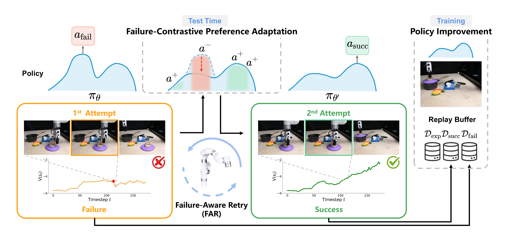

## FAR: Failure-Aware Retry for Test-Time Recovery and Continual Policy Improvement 

### [Paper](https://arxiv.org/pdf/2607.01111) | [Project Page](https://hoar012.github.io/FAR-Project/)

## News

- **2026.10.24** Code released. Give it a try!🚀🚀
- **2026.9.4** FAR has been accepted to CoRL 2026!🎉🎉

## Failure-Aware Retry

|  |
|:--:|
| After a failure, FAR identifies failure-inducing actions using value estimation, then updates the policy with both failure examples and alternative positive examples. The collected trajectories are added to the replay buffer for continual policy improvement. |

Visit our [Project Page](https://hoar012.github.io/FAR-Project/) for video demostrations.

## Setup :hammer_and_wrench:
Create a ```conda``` environment and install dependencies.
```bash
SUITE="robomimic" # [robomimic | maniskill | robocasa]
conda env create -f env_ymls/${SUITE}_env.yml

# Robocasa only, install the repository by a git clone.
git clone https://github.com/robocasa/robocasa
cd robocasa && git checkout 9f14a76cde2b87c473cbbc5a87eb975b80c2cab6 && pip install -e . && cd ..
```

## Expert demonstrations :floppy_disk:
Follow instructions in [datasets/README.md](https://github.com/Hoar012/FAR-scratch/blob/main/datasets/README.md) to download and extract the datasets for the given environments and suites. For RoboMimic tasks, we use the datasets provided in the benchamark, whereas demonstrations are collected for ManiSkill and RoboSuite tasks via a human teleoperator using a 3D space mouse. Once downloaded and extracted, run the following command to store videos of data loaded in the expert buffer to inspect if the expert dataset is loaded correctly.

## Training and evaluation
Example scripts are provided in ``scripts/``.

1. Pretraining a diffusion policy on expert demonstrations:
```bash
bash scripts/train.sh
```

2. Training a critic model on expert demonstrations:
```bash
bash scripts/critic.sh
```

3. Evaluate with FAR:
```bash
bash scripts/eval.sh
```

4. Continual policy improvement with FAR:
```bash
bash scripts/continual.sh
```

## BibTeX

```bibtex
@inproceedings{hao2026far,
    title={{FAR}: Failure-Aware Retry for Test-Time Recovery and Continual Policy Improvement},
    author={Haoran Hao and Shahram Najam Syed and Jeffrey Ichnowski and Jeff Schneider},
    booktitle={10th Annual Conference on Robot Learning},
    year={2026},
    url={https://openreview.net/forum?id=7jMlaTLtAc}
}
```